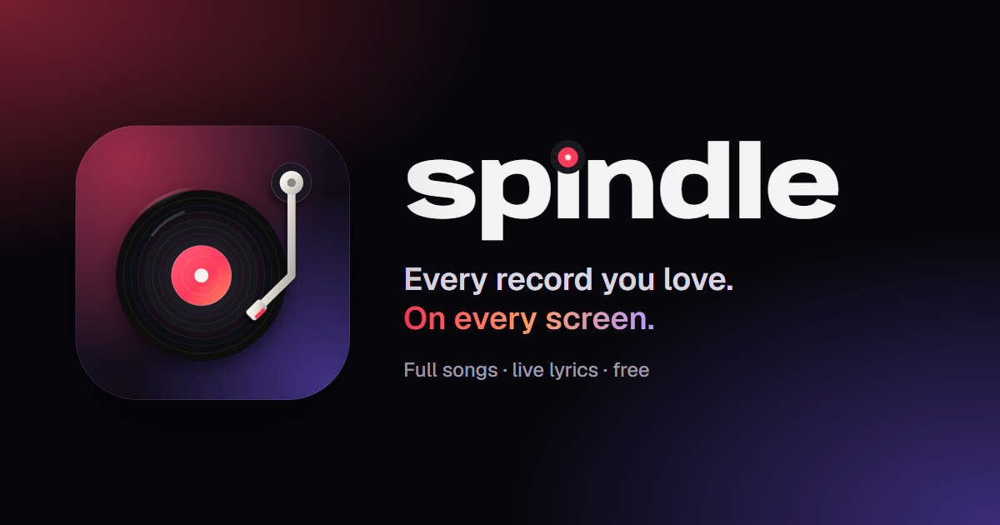

<div align="center">



# Spindle

**A free music player with full songs, live lyrics, karaoke, story cards and your library on every device.**

[**Open Spindle →**](https://spindle-bice.vercel.app)


</div>

---

Spindle is built like an after-hours record store: a living colour field behind everything, a crate of records to dig through, album sleeves you can turn over, and a turntable you can scratch. Every song plays in full, it's free, and there are no ads.

The name is the pin at the centre of a turntable that every record spins on. In the wordmark, the dot of the **i** is a tiny record that spins while music plays.

## Features

**Listening**
- Full songs for almost anything, through YouTube's official player, matched to the right upload automatically
- Live lyrics, synced line by line, with a Hinglish / हिन्दी switch for Hindi songs
- Karaoke: lyrics fill in word by word, and vocals can be swapped for an instrumental version or removed live
- A turntable player: drag the record to scrub, tap the deck to lift the needle
- **Autoplay** keeps the music going with similar songs when your queue runs out
- **Smart Shuffle** mixes recommended songs into a playlist, marked with ✦ so you can keep the ones you like

**Your library**
- Playlists with custom covers, drag to reorder, and list / grid / compact views
- **Recommended songs** under every playlist, from the artists it leans on
- Import from **Spotify, Apple Music and YouTube Music** by link or export file
- **Your stats**: minutes listened, top songs and artists, streaks, and a shareable stats card
- Downloads for offline listening (independent Audius tracks)

**Sharing**
- Share links with rich previews in WhatsApp, Discord, iMessage and X, like Spotify's
- Public share pages with 30-second previews and a way in to the full song
- **Story cards**: 1080×1920 images for Instagram, WhatsApp and Snapchat stories (cover, vinyl or lyrics looks)

**Everywhere**
- Accounts with GitHub or email (6-digit code), and a library that syncs live between devices
- Installable as an app from Safari or Chrome, opens offline, lock-screen controls
- **Desktop app** for Windows and Mac: Discord “Listening to” status, media keys, and music that keeps playing from the tray ([download](https://github.com/Somesh-Thakur/Spindle/releases/latest))
- **Feedback** page for bug reports and ideas, with replies from the developer
- Search across iTunes and YouTube Music at once (press **/** or **Ctrl+K**)

## Tech

| Layer | What |
| --- | --- |
| App | React 18, TypeScript, Vite, Framer Motion, Zustand |
| Graphics | WebGL colour field, Canvas story cards, Web Audio visuals and vocal remover |
| Accounts & sync | Supabase (Postgres, Auth, Realtime) with row-level security |
| Server | Vercel functions: importer, share pages, link-preview images |
| Music | YouTube IFrame API, iTunes Search, Audius, LRCLIB lyrics |

### How it fits together

```
src/
  api/          iTunes, YouTube lookup, Audius and lyrics clients
  components/   player, deck, share sheet, story maker, sign-in gate…
  lib/          sync engine, recommendations, autoplay, history & stats, story cards, offline
  pages/        Home, Browse, Search, Library, playlists, Stats, Settings, About…
  store/        the player and library state (persisted, synced)
server/         importer and share-page logic, shared by dev and Vercel
api/            Vercel functions: /api/import, /api/share (/s/:code), /api/og
supabase/       database schema and branded email templates
public/         brand assets, service worker, privacy and terms pages
```

- **Sync** (`src/lib/sync.ts`): each library is one JSON document of keyed entries. Devices send only what changed; the database merges entry by entry (newest wins, deletions carry over), and Realtime tells the other devices to pull.
- **Playback** (`src/components/AudioEngine.tsx`): finds the YouTube upload for each song, scoring title, artist and length, and falls back to the iTunes preview. Audius tracks play as audio files.
- **Recommendations** (`src/lib/recommend.ts`): the popular songs of the artists a playlist leans on, with name lookups for songs from YouTube or Audius.

## Run it locally

```bash
npm install
npm run dev
```

Open http://localhost:5173. Without Supabase keys, accounts are switched off and everything is saved on the device, which is handy for working on the UI.

### Tests

```bash
npm test
```

Vitest covers stats, recommendations, share pages (including escaping), the importer's link checks and the database rules, which run against a real Postgres in memory (PGlite). GitHub Actions runs the type-check, tests and a build on every push.

### Environment

Create `.env.local` (never committed):

```
VITE_SUPABASE_URL=https://<project>.supabase.co
VITE_SUPABASE_ANON_KEY=<publishable key>
VITE_AUTH_PROVIDERS=github            # sign-in buttons to show: github, google
VITE_DISCORD_INVITE=<optional>        # invite link for the community Discord, shown on Feedback and Settings
VITE_YT_API_KEY=<optional>            # YouTube Data API, only used if the free mirrors fail
```

The Supabase URL and publishable key are public by design; row-level security keeps every library private to its owner.

### Supabase setup

1. Create a project, then run [`supabase/schema.sql`](supabase/schema.sql) in the SQL Editor.
2. **Authentication → URL Configuration:** Site URL `https://spindle-bice.vercel.app`, redirect URLs for production and `http://localhost:5173`.
3. **Email:** keep *Confirm email* on, minimum password 8, 6-digit codes.
4. **Templates:** *Confirm signup* uses [`confirm-signup.html`](supabase/emails/confirm-signup.html) (subject `{{ .Token }} is your Spindle code`); *Reset password* uses [`reset-password.html`](supabase/emails/reset-password.html).
5. **SMTP:** connect a sender (Gmail with an app password, or Resend with your own domain). Supabase's built-in mailer only reaches your own team.
6. **GitHub / Google sign-in:** create an OAuth app with the callback `https://<project>.supabase.co/auth/v1/callback`, then paste its ID and secret under *Providers*.
7. **Admin inbox:** make yourself an admin so `#/admin` shows all feedback and crash reports:
   ```sql
   insert into public.admins select id from auth.users where email = 'you@example.com' on conflict do nothing;
   ```
8. **Discord alerts (optional):** in a Discord channel, *Edit channel → Integrations → Webhooks → New webhook → Copy webhook URL*, then save it. New feedback and new crashes post there:
   ```sql
   insert into private.settings values ('discord_webhook', 'https://discord.com/api/webhooks/…')
   on conflict (key) do update set value = excluded.value;
   ```

### Deploy

The project is deployed on Vercel and every push to `main` goes live. To deploy your own copy, import the repo into Vercel (free Hobby plan) and add the environment variables above.

## Desktop app

`desktop/` is a [Tauri](https://tauri.app) app: a small native window around the live site, using the browser engine already on the computer (WebView2 on Windows), so the installer is a few MB and it updates whenever the site does. It adds:

- Discord Rich Presence (“Listening to *song*” with cover art and a progress bar)
- Media keys, a tray icon, and closing to the tray while music plays
- Lower memory while hidden or minimised; outside links open in your browser
- Its own title bar, GitHub sign-in through your browser (via a `spindle://` link), and updates that install from inside the app

```bash
cd desktop
npm install
npm run dev     # run it
npm run build   # make an installer in src-tauri/target/release/bundle
```

It needs [Rust](https://rustup.rs). To show Discord status, create an application at [discord.com/developers](https://discord.com/developers/applications) named **Spindle** and build with its Application ID in `SPINDLE_DISCORD_APP_ID`. Pushing a tag like `desktop-v1.0.0` builds Windows and Mac installers on GitHub and publishes them as a release (set the ID as an Actions variable of the same name).

**Updates:** releases are signed so installed apps can update themselves. The signing key lives outside the repo; its contents go in the `TAURI_SIGNING_PRIVATE_KEY` Actions secret, and its public half is in `tauri.conf.json`. To ship an update, raise `version` in `desktop/src-tauri/tauri.conf.json` and `Cargo.toml`, then push a new `desktop-v…` tag. The release text becomes the notes in the app's update card. Website changes need no app update: the app loads the live site.

## Security

- Row-level security on every table: libraries are readable and writable only by their owner; shared links are readable by anyone with the code, without exposing who owns them.
- Database functions run with a fixed search path, and write functions are callable only when signed in.
- Security headers on every page (no framing, no MIME sniffing, strict referrer, locked-down permissions).
- No secrets in the repository: keys live in `.env.local` and Vercel's environment settings.
- Crashes are recorded to a write-only table (no one can read it from the site), capped in size and to 50 a day per person.

Found something? Please email the address on the [privacy page](https://spindle-bice.vercel.app/privacy) instead of opening a public issue.

## Keyboard

| Key | Action |
| --- | --- |
| Space | Play / pause |
| ← / → | Seek 5 seconds |
| Shift + ← / → | Previous / next song |
| ↑ / ↓ | Volume |
| M | Mute |
| F | Open / close the full player |
| / or Ctrl+K | Search |

## Credits

Songs stream from YouTube, Apple's iTunes previews and Audius; lyrics come from LRCLIB and lyrics.ovh. Spindle doesn't host or sell any music.

## Author

**Somesh Sanjay Thakur**, Full-Stack & AI Automation Dev. Crafting reactive web apps and autonomous agents with Next.js, React, Tailwind and Python. Shipping at the UX + LLM intersection.

[GitHub](https://github.com/Somesh-Thakur) · [LinkedIn](https://www.linkedin.com/in/somesh-thakur-30r07/) · [Instagram](https://www.instagram.com/itz__somesh_thakur/)

---

© Somesh Sanjay Thakur. All rights reserved.
